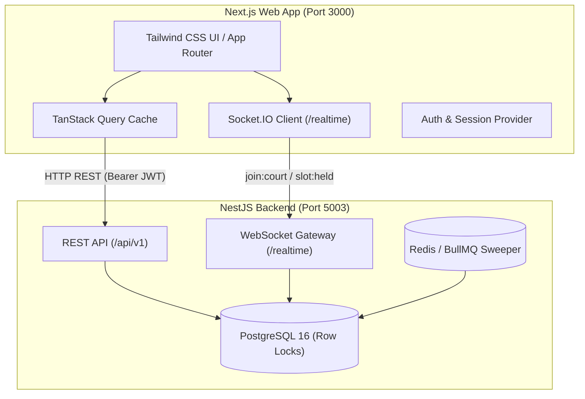

# DinkUp — Frontend Web Application

**Book a pickleball court in Chandigarh tricity — or join an open game with zero double-booking anxiety.**

DinkUp's frontend is a high-performance, real-time web application engineered for pickleball players and venue hosts across Chandigarh, Mohali, Panchkula, and Zirakpur.

- **Backend API:** `http://localhost:5003/api/v1`
- **WebSocket Gateway:** `http://localhost:5003/realtime`
- **UI/UX Design Specification:** [`docs/ui-ux-plan.md`](./docs/ui-ux-plan.md)
- **Frontend Architecture & Implementation Plan:** [`docs/frontend-architecture-plan.md`](./docs/frontend-architecture-plan.md)

---

## Highlights

- **Live Slot Availability:** Slot statuses (`AVAILABLE`, `HELD`, `BOOKED`, `BLOCKED`) synchronize in real-time across all connected clients via Socket.IO.
- **5-Minute Hold Countdown:** Monotonic, drift-free tabular countdown timer for active reservations with auto-release triggers and sticky checkout drawer.
- **Tricity Court Discovery:** Filter courts by city (`Chandigarh`, `Mohali`, `Panchkula`, `Zirakpur`) and amenities (`Floodlights`, `Paddle Rentals`, `Parking`, `Washrooms`, `Drinking Water`).
- **1-Tap WhatsApp Integration:** Instant direct messaging with court front desk managers.
- **Host Operational Portal:** Venue creation wizard, photo gallery manager (cover photo selector), court management, weekly schedule templates, and slot materialization.
- **Athletic Dark Theme:** High-contrast design system featuring Electric Volt Lime (`#D4FF00`), Deep Court Navy (`#0B0F17`), and unambiguous state badges.

---

## Tech Stack

| Layer | Tools |
| :--- | :--- |
| **Framework** | Next.js 16 (App Router) + React 19 |
| **Language** | TypeScript (Strict mode) |
| **Styling** | Tailwind CSS v4 + Tailwind Merge + CLSX |
| **Data Fetching & Cache** | TanStack Query v5 (`@tanstack/react-query`) |
| **Realtime Gateway** | Socket.IO Client (`socket.io-client`) |
| **Icons** | Lucide React |
| **Package Manager** | pnpm v12 |

---

## Architecture



---

## Getting Started

### Prerequisites

- **Node.js:** v20+ (v24 recommended)
- **pnpm:** v9+ (v12 recommended)
- **Backend Running:** Ensure `backend-dinkup` is active at `http://localhost:5003`

### 1. Installation

```bash
# Clone or navigate to the frontend directory
cd frontend-dinkup

# Install dependencies
pnpm install
```

### 2. Environment Configuration

Copy `.env.example` to `.env.local`:

```bash
cp .env.example .env.local
```

Default contents of `.env.local`:
```env
NEXT_PUBLIC_API_URL=http://localhost:5003/api/v1
NEXT_PUBLIC_SOCKET_URL=http://localhost:5003
NEXT_PUBLIC_APP_URL=http://localhost:3000
```

### 3. Run Development Server

```bash
pnpm dev
```

Open [http://localhost:3000](http://localhost:3000) in your browser.

---

## Project Structure

```
frontend-dinkup/
├── docs/
│   ├── ui-ux-plan.md                   # Full UI/UX specifications, wireframes & tokens
│   └── frontend-architecture-plan.md   # Data flow, queries, sockets & milestones
├── public/                             # Static assets
├── src/
│   ├── app/
│   │   ├── (public)/                   # Player & visitor routes
│   │   │   ├── page.tsx                # Tricity Venue Discovery Directory
│   │   │   ├── venues/[slug]/page.tsx  # Venue Profile & Live Slot Matrix
│   │   │   └── auth/                   # Login & Signup flows
│   │   ├── host/                       # Host Portal (Management routes)
│   │   ├── globals.css                 # Brand theme tokens & base styles
│   │   └── layout.tsx                  # Root layout with Query & Auth Providers
│   ├── components/                     # Modular React UI components
│   │   ├── ui/                         # Buttons, badges, modals, chips, inputs
│   │   ├── venues/                     # Venue cards, filters, amenities
│   │   └── slots/                      # DateStrip, SlotMatrix, HoldCountdownBar
│   ├── hooks/                          # Custom React hooks (realtime, timers, holds)
│   ├── lib/
│   │   ├── api.ts                      # Typed HTTP client with Bearer auth
│   │   ├── socket.ts                   # Socket.IO connection manager
│   │   └── utils.ts                    # Styling helpers (cn, formatters)
│   ├── providers/                      # Global context providers
│   │   ├── QueryProvider.tsx           # TanStack QueryClientProvider
│   │   └── AuthProvider.tsx            # Session state and local storage persistence
│   └── types/                          # Shared TypeScript definitions matching backend
├── .env.example
├── .env.local
├── package.json
└── README.md
```

---

## Design System Foundations

The interface is styled using an **Electric Pickleball Court** aesthetic:

| Token | Hex | Usage |
| :--- | :--- | :--- |
| `canvas-base` | `#0B0F17` | Canvas background (Deep graphite navy) |
| `surface-card` | `#161F30` | Cards, slot containers, modals |
| `surface-elevated` | `#1E2B42` | Dropdowns, popovers, drawers |
| `border-subtle` | `#2A3A56` | Card borders, dividers |
| `brand-volt` | `#D4FF00` | Primary CTA, logo glow, active badges |
| `accent-cyan` | `#00E5FF` | Court surface badges, focus rings |
| `status-avail-text`| `#10B981` | Available slot price & indicator |
| `status-held-text` | `#F59E0B` | Active 5-minute hold indicator |
| `status-block-text`| `#F87171` | Host maintenance locked slot |

---

## Available Scripts

- `pnpm dev` — Start the Next.js development server with Turbopack on port 3000
- `pnpm build` — Build the application for production
- `pnpm start` — Start the production build server
- `pnpm lint` — Run ESLint code checks

---

## Backend Reference

The NestJS backend runs at `http://localhost:5003`:
- **Swagger Docs:** `http://localhost:5003/api/docs`
- **Global API Prefix:** `http://localhost:5003/api/v1`
- **WebSocket Gateway:** `http://localhost:5003/realtime`

---

## License

MIT
