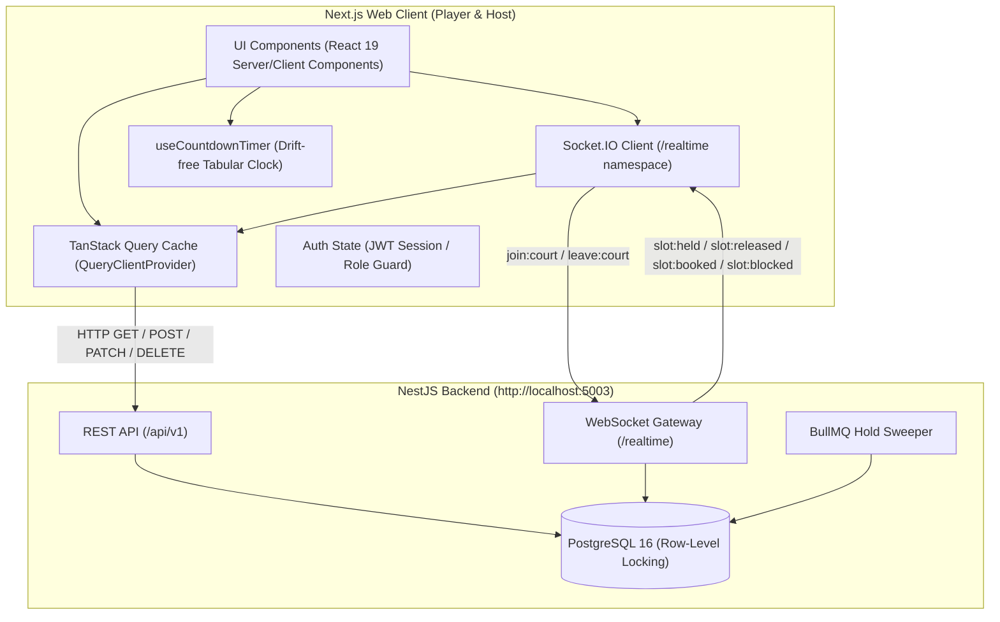

# DinkUp Frontend — Technical Architecture & Implementation Plan

> **Companion Document:** See [`docs/ui-ux-plan.md`](./ui-ux-plan.md) for UI/UX specifications, wireframes, and design tokens.  
> **Backend Integration:** NestJS Monolith running at `http://localhost:5003/api/v1` with WebSocket Gateway at `http://localhost:5003/realtime`.  
> **Target Stack:** Next.js 16 (App Router), React 19, TypeScript, Tailwind CSS v4, TanStack Query v5, Socket.IO Client v4, Lucide React.

---

## 1. System Architecture & Data Flow



---

## 2. Environment Configuration

### `.env.local`
```env
# Backend API Base URL
NEXT_PUBLIC_API_URL=http://localhost:5003/api/v1

# Realtime WebSocket URL
NEXT_PUBLIC_SOCKET_URL=http://localhost:5003

# Application Base URL
NEXT_PUBLIC_APP_URL=http://localhost:3000
```

---

## 3. Core TypeScript Models & Contracts

Matching the PostgreSQL database schema and NestJS DTOs:

### 3.1 Enums
- **`Role`**: `PLAYER` | `HOST` | `ADMIN`
- **`TricityCity`**: `CHANDIGARH` | `MOHALI` | `PANCHKULA` | `ZIRAKPUR`
- **`CourtSurface`**: `ACRYLIC_HARD` | `CUSHIONED_ACRYLIC` | `SYNTHETIC_TURF` | `WOODEN` | `CONCRETE`
- **`CourtType`**: `INDOOR` | `OUTDOOR` | `COVERED_ROOFTOP`
- **`DayOfWeek`**: `MONDAY` | `TUESDAY` | `WEDNESDAY` | `THURSDAY` | `FRIDAY` | `SATURDAY` | `SUNDAY`
- **`SlotStatus`**: `AVAILABLE` | `HELD` | `BOOKED` | `BLOCKED`
- **`BookingStatus`**: `PENDING` | `CONFIRMED` | `CANCELLED` | `EXPIRED` | `REFUNDED`

### 3.2 Entities
```ts
export interface User {
  id: number;
  email: string;
  name: string;
  phone?: string | null;
  role: Role;
  isActive: boolean;
  createdAt: string;
}

export interface VenueImage {
  id: number;
  venueId: number;
  url: string;
  isCover: boolean;
  displayOrder: number;
}

export interface Court {
  id: number;
  venueId: number;
  name: string;
  surface: CourtSurface;
  type: CourtType;
  basePricePerHour: number;
  isActive: boolean;
  schedules?: Schedule[];
}

export interface Schedule {
  id: number;
  courtId: number;
  dayOfWeek: DayOfWeek;
  openTime: string;  // "06:00"
  closeTime: string; // "23:00"
  slotDurationMinutes: number;
  priceOverride?: number | null;
}

export interface Slot {
  id: number;
  courtId: number;
  date: string;       // "YYYY-MM-DD"
  startTime: string;  // "06:00"
  endTime: string;    // "07:00"
  price: number;
  status: SlotStatus;
  heldBy?: number | null;
  holdExpiresAt?: string | null;
  version: number;
}

export interface Venue {
  id: number;
  hostId: number;
  name: string;
  slug: string;
  description?: string | null;
  city: TricityCity;
  area: string;
  address: string;
  googleMapsUrl?: string | null;
  latitude?: number | null;
  longitude?: number | null;
  hasLighting: boolean;
  hasEquipmentRental: boolean;
  hasParking: boolean;
  hasWashroom: boolean;
  hasDrinkingWater: boolean;
  contactPhone?: string | null;
  whatsappNumber?: string | null;
  contactEmail?: string | null;
  cancellationCutoffHours: number;
  isActive: boolean;
  images: VenueImage[];
  courts: Court[];
}
```

---

## 4. API Endpoints & TanStack Query Keys

| Resource | Method & Path | Query Key / Mutation | Purpose |
| :--- | :--- | :--- | :--- |
| **Auth** | `POST /api/v1/auth/signup` | `useMutation(signup)` | Player / Host signup |
| **Auth** | `POST /api/v1/auth/login` | `useMutation(login)` | Authenticate session |
| **Auth** | `GET /api/v1/auth/me` | `['auth', 'me']` | Current user profile |
| **Venues** | `GET /api/v1/venues` | `['venues', { city, area, lighting... }]` | Tricity Discovery List |
| **Venues** | `GET /api/v1/venues/:idOrSlug` | `['venue', slug]` | Single venue profile + courts |
| **Venues (Host)** | `POST /api/v1/venues` | `useMutation(createVenue)` | Host creates venue |
| **Venues (Host)** | `PATCH /api/v1/venues/:id` | `useMutation(updateVenue)` | Update venue details |
| **Venues (Host)** | `POST /api/v1/venues/:id/images` | `useMutation(uploadImage)` | Upload court photo |
| **Venues (Host)** | `PATCH /api/v1/venues/:id/images/:imgId/cover` | `useMutation(setCover)` | Select primary cover |
| **Courts (Host)** | `POST /api/v1/courts` | `useMutation(createCourt)` | Add court to venue |
| **Schedule (Host)**| `PUT /api/v1/schedule` | `useMutation(saveSchedules)` | Batch weekly schedule |
| **Slots (Host)** | `POST /api/v1/courts/:id/slots/generate` | `useMutation(generateSlots)`| Materialize slots for date range |
| **Slots** | `GET /api/v1/courts/:id/slots?date=` | `['slots', courtId, date]` | Date-specific court slots |
| **Slots (Player)**| `POST /api/v1/slots/:id/hold` | `useMutation(holdSlot)` | Atomic 5-min slot hold |
| **Slots (Player)**| `POST /api/v1/slots/:id/release` | `useMutation(releaseSlot)` | Release hold |
| **Slots (Host)** | `POST /api/v1/slots/:id/block` | `useMutation(blockSlot)` | Host maintenance lock |
| **Slots (Host)** | `POST /api/v1/slots/:id/unblock` | `useMutation(unblockSlot)` | Host maintenance unlock |

---

## 5. Real-Time Synchronization Protocol (`/realtime`)

The socket client connects to `http://localhost:5003/realtime`.

### 5.1 Room Lifecycle
1. When a user navigates to `/venues/[slug]` and selects `courtId = 4` on date `2026-10-28`:
   ```ts
   socket.emit('join:court', { courtId: 4, date: '2026-10-28' });
   ```
2. When the user switches dates or courts:
   ```ts
   socket.emit('leave:court', { courtId: oldCourtId, date: oldDate });
   socket.emit('join:court', { courtId: newCourtId, date: newDate });
   ```

### 5.2 Broadcast Handler Strategy
- `slot:held` → Updates TanStack Query cache item `['slots', courtId, date]` in place:
  - If `data.heldBy === currentUserId` → Mark as `HELD_BY_ME`, initialize timer with `holdExpiresAt`.
  - Else → Mark as `HELD_BY_OTHER`, display "Reserved".
- `slot:released` → Slot status returns to `AVAILABLE`.
- `slot:booked` → Slot status moves to `BOOKED`.
- `slot:blocked` → Slot status moves to `BLOCKED`.

---

## 6. Project Directory Architecture

```
src/
├── app/
│   ├── (public)/
│   │   ├── page.tsx                    # Tricity Venue Directory & Filter
│   │   ├── venues/
│   │   │   └── [slug]/
│   │   │       └── page.tsx            # Venue Profile, Court Tabs & Live Slot Grid
│   │   └── auth/
│   │       ├── login/page.tsx          # Login Page
│   │       └── signup/page.tsx         # Signup (Player vs Host)
│   ├── host/
│   │   ├── layout.tsx                  # Host Portal Layout (Sidebar + Auth Guard)
│   │   ├── dashboard/page.tsx          # My Venues Metrics & Quick Actions
│   │   ├── venues/
│   │   │   ├── new/page.tsx            # Create Venue Wizard
│   │   │   └── [id]/
│   │   │       ├── page.tsx            # Edit Venue & Amenities
│   │   │       ├── photos/page.tsx     # Photo Uploads & Cover Manager
│   │   │       └── courts/
│   │   │           └── [courtId]/
│   │   │               ├── schedule/page.tsx # Weekly Schedule Template
│   │   │               └── slots/page.tsx    # Live Maintenance Grid & Slot Materializer
│   ├── layout.tsx                      # Root Layout & Global Providers
│   └── globals.css                     # Design System Theme & Utility Tokens
├── components/
│   ├── ui/                             # Button, Badge, Modal, Input, Toast, Skeleton
│   ├── layout/                         # Header, MobileNav, Footer
│   ├── venues/                         # VenueCard, CityFilter, AmenityFilterPills
│   ├── slots/                          # DateStrip, SlotMatrix, SlotChip, HoldBar
│   └── host/                           # VenueForm, CourtManager, ScheduleForm
├── hooks/
│   ├── useAuth.ts                      # Session, Token & Role Management
│   ├── useRealtimeCourt.ts             # Socket.IO join/leave and event subscriptions
│   ├── useSlotHold.ts                  # Hold/Release slot mutations with optimistic UI
│   └── useCountdownTimer.ts            # High-precision tabular countdown timer
├── lib/
│   ├── api.ts                          # Fetch / Axios client with Bearer token interceptor
│   ├── socket.ts                       # Singleton Socket.IO instance pointing to /realtime
│   └── utils.ts                        # Styling (cn) and formatting helpers
├── providers/
│   ├── QueryProvider.tsx               # TanStack QueryClientProvider
│   └── AuthProvider.tsx                # Auth context with token persistence
└── types/                              # Shared TypeScript types & API contracts
```

---

## 7. Implementation Milestones

- **Milestone 1:** Foundation Setup (Theme Tokens, Axios API Client, Socket.IO Client, QueryProvider, Auth Context).
- **Milestone 2:** Public Discovery & Tricity Venue Filtering (Chandigarh, Mohali, Panchkula, Zirakpur).
- **Milestone 3:** Venue Profile, Court Switcher & Photo Showcase.
- **Milestone 4:** Live Court Slot Schedule Matrix with Real-Time WebSockets & 5-Minute Hold Countdown.
- **Milestone 5:** Host Portal (Venue Creation, Photo Management, Court Configuration, Weekly Schedule, Slot Generation & Maintenance Locking).
