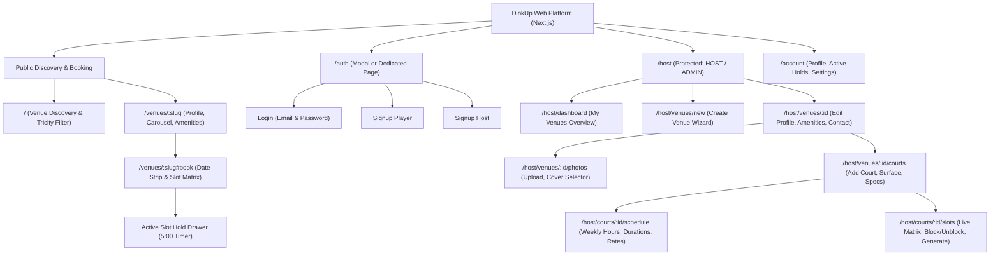
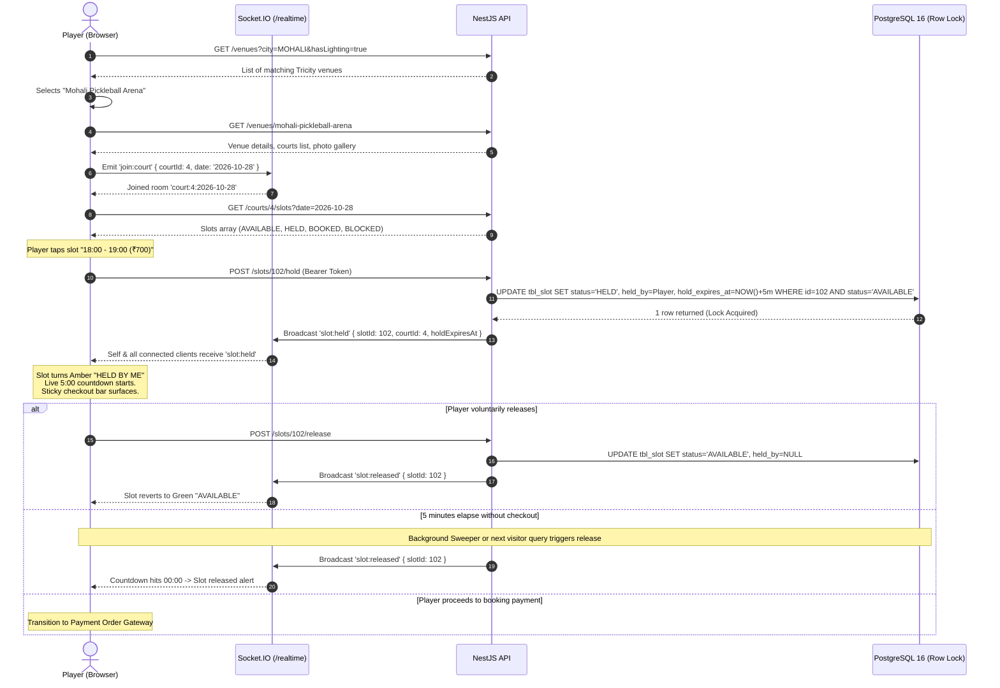
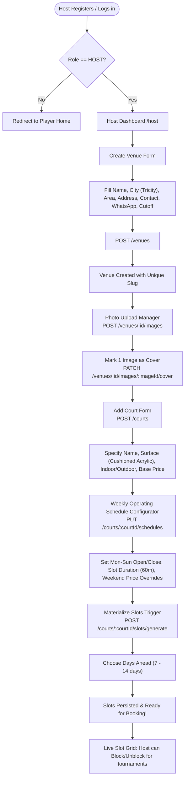
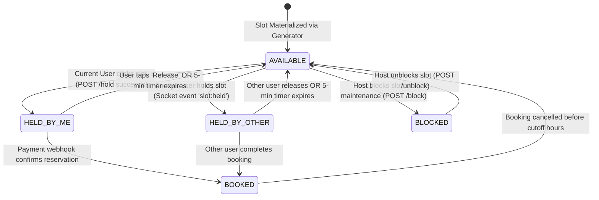

# DinkUp — UI/UX Planning & Design Architecture Specification

> **Version:** 1.0.0  
> **Target Platform:** Next.js (App Router), Tailwind CSS, TanStack Query, Socket.IO Client  
> **Backend Integration:** NestJS API, PostgreSQL 16 (Row-Level Locking), Redis + BullMQ, Socket.IO `/realtime`  
> **Geographic Focus:** Chandigarh Tricity (Chandigarh, Mohali, Panchkula, Zirakpur)

---

## 1. Executive Summary & Product Vision

### 1.1 Brand Identity & Proposition
**DinkUp** is a dedicated, hyper-reliable pickleball court booking platform tailored specifically for the Chandigarh Tricity metropolitan area. 

The sport of pickleball is fast, social, and energetic. DinkUp translates this ethos into an ultra-responsive, high-contrast, tactile digital experience. The interface balances **athletic vitality** (neon court greens, high-energy accents) with **serious transactional clarity** (deep slate backdrops, zero visual clutter, unambiguous availability states).

### 1.2 Core Product Principles
1. **Zero Double-Booking Anxiety:** The interface visually communicates backend atomic guarantees. Players know immediately whether a slot is free, held, or confirmed.
2. **Transparent 5-Minute Hold Clock:** A live, synchronized countdown timer provides clear, panic-free urgency during the booking window.
3. **Frictionless Local Contact:** Chandigarh players frequently require court specs, paddle rentals, or direct host communication. 1-tap WhatsApp chat and direct phone links are prominently positioned.
4. **Mobile-First Court Ergonomics:** 80%+ of reservations occur on mobile phones near the court or on the go. Every tap target exceeds 44×44px, and slot matrices support rapid horizontal and vertical thumb scanning.
5. **Host Operational Empowerment:** Venue managers can configure complex weekly schedules, override weekend rates, upload facility photos, and block slots for private tournaments in seconds.

---

## 2. Design System Foundations

### 2.1 Color Palette & Semantic Tokens
The palette is built around an **Electric Pickleball Court** aesthetic: deep dark mode charcoal/navy as the bedrock for high contrast, combined with high-visibility electric lime, court court-blue accents, and definitive state colors.

```
                    DINKUP BRAND COLOR PALETTE
┌───────────────────────┬───────────────────────┬───────────────────────┐
│     VOLT LIME         │     COURT SLATE       │     SURFACE DARK      │
│     #D4FF00           │     #0B0F17           │     #161F30           │
│     Brand Accent      │     Primary Canvas    │     Card / Surface    │
├───────────────────────┼───────────────────────┼───────────────────────┤
│     CYAN NET          │     AMBER HOLD        │     CRIMSON BLOCKED   │
│     #00E5FF           │     #F59E0B           │     #EF4444           │
│     Interactive Blue  │     Active 5m Hold    │     Locked / Blocked  │
└───────────────────────┴───────────────────────┴───────────────────────┘
```

#### Token Mapping Table
| Token Name | Hex Code | Purpose / Usage | WCAG Contrast (on Canvas) |
| :--- | :--- | :--- | :--- |
| `canvas-base` | `#0B0F17` | Main page background (Deep graphite navy) | Baseline (1.0) |
| `surface-card` | `#161F30` | Cards, slot containers, modals | 2.1:1 vs base |
| `surface-elevated` | `#1E2B42` | Dropdowns, tooltips, floating bars | 3.2:1 vs base |
| `border-subtle` | `#2A3A56` | Card borders, dividers, chip outlines | 4.8:1 vs base |
| `brand-volt` | `#D4FF00` | Primary CTA, active selections, logo glow | 15.2:1 vs base (AAA) |
| `brand-volt-hover` | `#BDDF00` | CTA hover state | 13.8:1 vs base (AAA) |
| `accent-cyan` | `#00E5FF` | Court surface badges, info chips, focus rings | 12.6:1 vs base (AAA) |
| `text-primary` | `#F8FAFC` | Main headings, slot times, primary copy | 18.2:1 vs base (AAA) |
| `text-secondary` | `#94A3B8` | Subtitles, venue areas, amenities, metadata | 8.5:1 vs base (AAA) |
| `text-muted` | `#64748B` | Inactive dates, closed days, disabled text | 4.6:1 vs base (AA) |
| `status-avail-bg` | `#132E27` | Available slot chip background | Subtle dark emerald |
| `status-avail-text`| `#10B981` | Available slot price text & indicator dot | 7.9:1 vs card (AAA) |
| `status-held-bg` | `#332200` | Held slot chip background | Deep amber tint |
| `status-held-text` | `#F59E0B` | Held slot timer, hold indicator | 8.1:1 vs card (AAA) |
| `status-booked-bg` | `#1E2530` | Booked slot background (disabled) | Muted charcoal |
| `status-booked-text`| `#475569`| Booked slot label | 3.1:1 vs card |
| `status-block-bg` | `#2B1214` | Host blocked / maintenance slot | Dark crimson hatch |
| `status-block-text`| `#F87171`| Blocked badge text | 6.8:1 vs card (AAA) |

### 2.2 Typography Hierarchy
- **Primary Font Family:** `Plus Jakarta Sans` or `Inter` (geometric, athletic, modern sans).
- **Numbers / Timers:** `font-variant-numeric: tabular-nums` (prevents jitter during live 5-minute countdowns).

| Style | Size | Weight | Line Height | Tracking | Application |
| :--- | :--- | :--- | :--- | :--- | :--- |
| **Display 1** | 36px / 2.25rem | 800 (Extrabold) | 1.15 | -0.03em | Venue Hero Titles, Landing Headlines |
| **Heading 1** | 24px / 1.5rem | 700 (Bold) | 1.25 | -0.02em | Section Headers, Host Dashboard H1 |
| **Heading 2** | 20px / 1.25rem | 600 (Semibold) | 1.3 | -0.01em | Modal Headers, Court Switcher Tabs |
| **Heading 3** | 16px / 1.0rem | 600 (Semibold) | 1.4 | 0 | Card Titles, Date Strip Day Names |
| **Body 1** | 15px / 0.9375rem | 400 (Regular) | 1.5 | 0 | Venue Descriptions, Policies, Form Labels |
| **Body 2** | 13px / 0.8125rem | 400 (Regular) | 1.5 | 0 | Timestamps, Secondary Amenity Labels |
| **Timer / Numerics**| 18px / 1.125rem | 700 (Bold) | 1.0 | 0.05em | Tabular Live 5:00 Hold Countdown |
| **Badge / Pill** | 11px / 0.6875rem | 700 (Bold) | 1.0 | 0.08em uppercase | Court Surface, Indoor/Outdoor, Status |

### 2.3 Spacing, Borders & Elevation
- **Base Grid:** 4px / 8px baseline rhythm (`gap-2`, `gap-4`, `p-4`, `p-6`).
- **Border Radii:**
  - Micro (Chips, Pills, Badges): `rounded-full` or `rounded-md` (6px)
  - Components (Slot Cards, Inputs, Buttons): `rounded-xl` (12px)
  - Containers (Venue Cards, Modals, Bottom Sheets): `rounded-2xl` (16px) or `rounded-3xl` (24px)
- **Elevation Layers:**
  - `elevation-0`: Surface card (`bg-[#161F30] border border-[#2A3A56]`)
  - `elevation-1`: Dropdowns, popovers (`bg-[#1E2B42] shadow-xl shadow-black/40 border border-[#3B4D70]`)
  - `elevation-2`: Sticky bottom checkout drawer / Hold bar (`backdrop-blur-md bg-[#0B0F17]/95 border-t border-[#2A3A56] shadow-2xl`)
  - `elevation-3`: Modal overlay (`backdrop-blur-sm bg-black/75 z-50`)

---

## 3. Information Architecture & Sitemap

### 3.1 Role-Based Access Matrix
| Feature / Route | Guest (Unauthenticated) | Player (Authenticated) | Host (Venue Owner) | Admin |
| :--- | :---: | :---: | :---: | :---: |
| Browse Tricity Venues (`GET /venues`) | Full Access | Full Access | Full Access | Full Access |
| View Venue Profile (`/venues/:slug`) | Full Access | Full Access | Full Access | Full Access |
| View Live Slots (`GET /courts/:id/slots`) | Full Access | Full Access | Full Access | Full Access |
| Hold Slot (`POST /slots/:id/hold`) | Redirect to Login modal | **Can Hold (5m lock)** | Can Hold | Can Hold |
| Release Held Slot (`POST /slots/:id/release`) | N/A | **Can Release own hold** | Can Release own hold | Can Release any hold |
| Create Venue (`POST /venues`) | Hidden / 403 | Hidden / 403 | **Full Access** | Full Access |
| Edit Venue / Photos (`PATCH /venues/:id`) | Hidden / 403 | Hidden / 403 | **Own Venues only** | All Venues |
| Add / Edit Courts (`POST /courts`) | Hidden / 403 | Hidden / 403 | **Own Venues only** | All Venues |
| Configure Schedules (`PUT /schedules`) | Hidden / 403 | Hidden / 403 | **Own Courts only** | All Courts |
| Generate Slots (`POST /slots/generate`) | Hidden / 403 | Hidden / 403 | **Own Courts only** | All Courts |
| Block / Unblock Slots (`POST /slots/:id/block`)| Hidden / 403 | Hidden / 403 | **Own Courts only** | All Courts |

### 3.2 Global Sitemap Tree



---

## 4. End-to-End User Journeys & Flowcharts

### 4.1 Player Journey: Discovery -> Real-Time Slot Hold -> Checkout Handover



### 4.2 Host Journey: Venue Setup, Weekly Schedules & Slot Materialization



---

## 5. Screen-by-Screen Detailed Wireframes & Component Specs

### 5.1 Screen 1: Auth & Onboarding (Modal & Page)
**Purpose:** Frictionless registration and authentication for Players and Hosts with zero role ambiguity.

#### Mobile & Desktop Wireframe (Dual-Tab Modal / Dedicated Route)
```
┌─────────────────────────────────────────────────────────────┐
│  DinkUp                     [✕ Close]                       │
├─────────────────────────────────────────────────────────────┤
│   ┌───────────────────────────┬───────────────────────────┐ │
│   │        Log In             │        Sign Up            │ │
│   └───────────────────────────┴───────────────────────────┘ │
│                                                             │
│   Welcome to Tricity Pickleball                             │
│   Book courts across Chandigarh, Mohali, Panchkula & Zirakpur│
│                                                             │
│   I am joining as:                                          │
│   ┌──────────────────────────┬────────────────────────────┐ │
│   │  ● PLAYER                │  ○ HOST / VENUE OWNER      │ │
│   │  Book courts & games     │  List courts & manage slots│ │
│   └──────────────────────────┴────────────────────────────┘ │
│                                                             │
│   Full Name *                                               │
│   [ Enter your name                                       ] │
│                                                             │
│   Email Address *                                           │
│   [ player@dinkup.in                                      ] │
│                                                             │
│   Mobile Phone (Optional - For WhatsApp Booking Updates)    │
│   [ +91 98765 43210                                       ] │
│                                                             │
│   Password * (Min 8 characters)                             │
│   [ •••••••••••••                                   (👁)  ] │
│                                                             │
│   ┌───────────────────────────────────────────────────────┐ │
│   │             CREATE ACCOUNT (⚡ Volt Lime)             │ │
│   └───────────────────────────────────────────────────────┘ │
│                                                             │
│   By continuing, you agree to DinkUp's Terms of Service.    │
└─────────────────────────────────────────────────────────────┘
```

#### Field Specifications & Validation Rules
- **Role Selector:** Radio card pill (`PLAYER` or `HOST`). Note: `ADMIN` cannot be self-assigned (enforced by backend validation).
- **Email:** Strict RFC regex, auto-lowercased and trimmed.
- **Phone:** Indian format validation (`+91` or 10-digit format), stored in international format.
- **Password:** Minimum 8 characters, Argon2 hashed on backend.
- **Session Management:** Response returns `accessToken` (JWT 7-day expiry) and user object (`id, email, name, role`). Client stores JWT in secure `httpOnly` cookie or memory with refresh strategy.

---

### 5.2 Screen 2: Tricity Venue Discovery & Directory

#### Desktop Wireframe (1280px+)
```
┌──────────────────────────────────────────────────────────────────────────────────────────────┐
│ [DinkUp Logo ⚡]   [ Chandigarh ▼ ]   [ Search area, venue... 🔍 ]        (Host Portal) (Login) │
├──────────────────────────────────────────────────────────────────────────────────────────────┤
│ CITY FILTER:                                                                                 │
│ [ All Tricity ]  [★ Chandigarh ]  [ Mohali ]  [ Panchkula ]  [ Zirakpur ]                    │
│                                                                                              │
│ AMENITY & FEATURE PILLS:                                                                     │
│ [✓ Night Lighting 💡]  [ Equipment Rental 🏓]  [ Parking 🚗]  [ Washroom 🚻]  [ Drinking Water 💧]│
├──────────────────────────────────────────────────────────────────────────────────────────────┤
│ EXPLORING 8 VENUES IN CHANDIGARH TRICITY                                                     │
│                                                                                              │
│ ┌───────────────────────────────┐ ┌───────────────────────────────┐ ┌──────────────────────┐ │
│ │ [ COVER PHOTO CAROUSEL ]      │ │ [ COVER PHOTO CAROUSEL ]      │ │ [ COVER PHOTO ]      │ │
│ │  📍 Sector 42, Chandigarh     │ │  📍 Phase 8 Ind. Area, Mohali │ │  📍 Sector 20, Pkl   │ │
│ │ ───────────────────────────── │ │ ───────────────────────────── │ │ ──────────────────── │ │
│ │ Chandigarh Club Pickleball    │ │ Mohali Pickleball Arena       │ │ Panchkula Smash Hub  │ │
│ │ ★ 4.9 (42 reviews)            │ │ ★ 4.8 (89 reviews)            │ │ ★ 4.7 (19 reviews)   │ │
│ │                               │ │                               │ │                      │ │
│ │ 3 Courts • Cushioned Acrylic  │ │ 4 Courts • Hard Acrylic       │ │ 2 Courts • Turf      │ │
│ │ [💡 Floodlights] [🏓 Rentals]  │ │ [💡 Floodlights] [🚗 Parking] │ │ [🚻 Washroom]        │ │
│ │                               │ │                               │ │                      │ │
│ │ From ₹600 / hr                │ │ From ₹700 / hr                │ │ From ₹500 / hr       │ │
│ │ ┌───────────────────────────┐ │ │ ┌───────────────────────────┐ │ │ ┌──────────────────┐ │ │
│ │ │ View Courts & Book ➔      │ │ │ │ View Courts & Book ➔      │ │ │ │ View Courts ➔    │ │ │
│ │ └───────────────────────────┘ │ │ └───────────────────────────┘ │ │ └──────────────────┘ │ │
│ └───────────────────────────────┘ └───────────────────────────────┘ └──────────────────────┘ │
└──────────────────────────────────────────────────────────────────────────────────────────────┘
```

#### Mobile Wireframe (390px Mobile Web / PWA)
```
┌───────────────────────────────────────┐
│ ⚡ DinkUp          [📍 Mohali ▼]  (👤) │
├───────────────────────────────────────┤
│ [ 🔍 Search Sector, Phase, Venue... ] │
├───────────────────────────────────────┤
│ Horizontal City Strip:                │
│ [All] [Chandigarh] [● Mohali] [Panch] ➔│
├───────────────────────────────────────┤
│ Amenity Filters (Horizontal Scroll):  │
│ [💡 Lights] [🏓 Rentals] [🚗 Parking] ➔│
├───────────────────────────────────────┤
│ 4 Venues Available in Mohali          │
│                                       │
│ ┌───────────────────────────────────┐ │
│ │ [ PHOTO: Mohali Pickleball Arena] │ │
│ │ (1/5)  [★ 4.8]      [From ₹700/hr]│ │
│ ├───────────────────────────────────┤ │
│ │ Mohali Pickleball Arena           │ │
│ │ Phase 8 Industrial Area, Mohali   │ │
│ │ 4 Courts • Cushioned Acrylic      │ │
│ │                                   │ │
│ │ [💡 Night Lights] [🏓 Rentals]     │ │
│ │ [🚗 Free Parking] [💧 Water]       │ │
│ │                                   │ │
│ │ ┌───────────────────────────────┐ │ │
│ │ │ Check Available Slots ➔       │ │ │
│ │ └───────────────────────────────┘ │ │
│ └───────────────────────────────────┘ │
│                                       │
│ ┌───────────────────────────────────┐ │
│ │ [ PHOTO: JLPL Sports Complex]     │ │
│ │ (1/3)  [★ 4.6]      [From ₹500/hr]│ │
│ └───────────────────────────────────┘ │
├───────────────────────────────────────┤
│ [🏠 Venues]   [📅 My Bookings]  [👤] │
└───────────────────────────────────────┘
```

#### Component & Query Logic
- **City Filter:** Matches `TricityCity` enum (`CHANDIGARH`, `MOHALI`, `PANCHKULA`, `ZIRAKPUR`).
- **Amenity Pills:** Multiselect toggles mapping directly to `VenueQueryDto` (`hasLighting=true`, `hasEquipmentRental=true`).
- **Instant Search:** Debounced (300ms) text search querying venue name, area, and address.
- **Card Pricing:** Computed from `MIN(courts.basePricePerHour)`.
- **Image Fallback:** High-resolution SVG geometric court illustration if no venue photos are uploaded.

---

### 5.3 Screen 3: Venue & Court Profile (`/venues/:slug`)

#### Desktop Wireframe (1280px+)
```
┌──────────────────────────────────────────────────────────────────────────────────────────────┐
│ [← Back to Venues]   /venues/mohali-pickleball-arena                  [Share ↗] [❤️ Favorite]│
├──────────────────────────────────────────────────────────────────────────────────────────────┤
│ ┌──────────────────────────────────────────────┬───────────────────────┬───────────────────┐ │
│ │                                              │ [ Gallery Image 2 ]   │ [ Gallery Image 4]│ │
│ │           PRIMARY COVER PHOTO                ├───────────────────────┼───────────────────┤ │
│ │                                              │ [ Gallery Image 3 ]   │ [ View All (8) ⊞ ]│ │
│ └──────────────────────────────────────────────┴───────────────────────┴───────────────────┘ │
│                                                                                              │
│ ┌───────────────────────────────────────────────────────┬──────────────────────────────────┐ │
│ │ Mohali Pickleball Arena                               │ VENUE CONTACT & BOOKING INFO     │ │
│ │ 📍 Plot 42, Sector 82, JLPL Industrial Area, Mohali   │                                  │ │
│ │ [🗺 View on Google Maps ↗]                             │ ┌──────────────────────────────┐ │ │
│ │                                                       │ │ 💬 Chat on WhatsApp          │ │ │
│ │ ABOUT THE FACILITY                                    │ │ (Opens 1-tap wa.me chat)     │ │ │
│ │ Premium 4-court indoor/outdoor facility with USA      │ └──────────────────────────────┘ │ │
│ │ Pickleball certified cushioned acrylic surfacing.     │                                  │ │
│ │                                                       │ 📞 Front Desk: +91 98765 43210   │ │
│ │ AMENITIES INCLUDED                                    │ ✉️ Support: info@mohalipb.com    │ │
│ │ [💡 LED Tournament Floodlights] [🏓 Paddle Rental ₹50]│                                  │ │
│ │ [🚗 40+ Car Parking Spaces]   [🚻 Clean Locker Rooms] │ 🛡️ CANCELLATION POLICY           │ │
│ │ [💧 Purified RO Water Station]                        │ Free cancellation up to 6 hours  │ │
│ │                                                       │ before your slot starts.         │ │
│ └───────────────────────────────────────────────────────┴──────────────────────────────────┘ │
└──────────────────────────────────────────────────────────────────────────────────────────────┘
```

#### Court Switcher Tabs (Directly above Slot Matrix)
```
┌──────────────────────────────────────────────────────────────────────────────────────────────┐
│ SELECT COURT:                                                                                │
│ ┌───────────────────────────┐  ┌────────────────────────┐  ┌────────────────────────┐        │
│ │ ● Court 1 (Centre Court)  │  │ Court 2 (East Court)   │  │ Court 3 (Covered Roof) │  ...   │
│ │ Cushioned Acrylic • ₹700  │  │ Cushioned Acrylic • ₹700│  │ Wooden Indoor • ₹900   │        │
│ └───────────────────────────┘  └────────────────────────┘  └────────────────────────┘        │
└──────────────────────────────────────────────────────────────────────────────────────────────┘
```

#### 1-Tap WhatsApp Integration
- URL Scheme: `https://wa.me/{sanitizedWhatsappNumber}?text=Hi%2C%20I%20have%20an%20inquiry%20about%20booking%20a%20pickleball%20court%20at%20{venueName}%20via%20DinkUp`
- Sanitization: Automatically strips spaces, dashes, brackets, and prepends country code `91` if missing.

---

### 5.4 Screen 4: Interactive Court Schedule & Live Slot Matrix

#### Live Date Selector (Horizontal Scroll Strip: Today + 14 Days)
```
┌──────────────────────────────────────────────────────────────────────────────────────────────┐
│ DATE SELECTOR (October - November 2026):                                                     │
│ ┌───────┐ ┌────────┐ ┌────────┐ ┌────────┐ ┌────────┐ ┌────────┐ ┌────────┐ ┌────────┐       │
│ │ TODAY │ │ WED    │ │ THU    │ │ FRI    │ │ SAT    │ │ SUN    │ │ MON    │ │ TUE    │  ➔    │
│ │ 27    │ │ 28     │ │ 29     │ │ 30     │ │ 31 ★   │ │ 01 ★   │ │ 02     │ │ 03     │       │
│ │ OCT   │ │ OCT    │ │ OCT    │ │ OCT    │ │ OCT    │ │ NOV    │ │ NOV    │ │ NOV    │       │
│ │ ● 8 Av│ │ ● 12 Av│ │ ● 10 Av│ │ ● 5 Av │ │ ● 2 Av │ │ ⊘ Sold │ │ ● 14 Av│ │ ● 11 Av│       │
│ │[ACTIVE] │        │          │          │ (Peak ₹) │ (Peak ₹) │          │          │       │
│ └───────┘ └────────┘ └────────┘ └────────┘ └────────┘ └────────┘ └────────┘ └────────┘       │
└──────────────────────────────────────────────────────────────────────────────────────────────┘
```

#### Slot Matrix (Grouped by Time of Day)
```
┌──────────────────────────────────────────────────────────────────────────────────────────────┐
│ Court 1 (Centre Court) — Tuesday, 27 October 2026                                            │
│ [🟢 Live Availability Connected — WebSockets Active]                                         │
├──────────────────────────────────────────────────────────────────────────────────────────────┤
│ 🌅 MORNING (06:00 - 12:00)                                                                   │
│ ┌──────────────┐  ┌──────────────┐  ┌──────────────┐  ┌──────────────┐                       │
│ │ 06:00 - 07:00│  │ 07:00 - 08:00│  │ 08:00 - 09:00│  │ 09:00 - 10:00│                       │
│ │ ₹700         │  │ ₹700         │  │ 🔒 RESERVED  │  │ ✕ BOOKED     │                       │
│ │ [ AVAILABLE ]│  │ [ AVAILABLE ]│  │ (Held by oth)│  │ (Confirmed)  │                       │
│ └──────────────┘  └──────────────┘  └──────────────┘  └──────────────┘                       │
│                                                                                              │
│ ☀️ AFTERNOON (12:00 - 17:00)                                                                 │
│ ┌──────────────┐  ┌──────────────┐  ┌──────────────┐  ┌──────────────┐                       │
│ │ 12:00 - 13:00│  │ 13:00 - 14:00│  │ 14:00 - 15:00│  │ 15:00 - 16:00│                       │
│ │ ▨ BLOCKED    │  │ ₹700         │  │ ₹700         │  │ ₹700         │                       │
│ │ (Maintenance)│  │ [ AVAILABLE ]│  │ [ AVAILABLE ]│  │ [ AVAILABLE ]│                       │
│ └──────────────┘  └──────────────┘  └──────────────┘  └──────────────┘                       │
│                                                                                              │
│ 🌙 PRIME EVENING & NIGHT (17:00 - 23:00)                                                     │
│ ┌──────────────────────────────────────────────┐  ┌──────────────┐  ┌──────────────┐         │
│ │ 18:00 - 19:00  ★ HELD BY YOU                 │  │ 19:00 - 20:00│  │ 20:00 - 21:00│         │
│ │ ₹700 • Live Countdown: 04:38 remaining       │  │ ₹700         │  │ ✕ BOOKED     │         │
│ │ [ progress bar: ████████████████░░░░░░░░░░ ] │  │ [ AVAILABLE ]│  │ (Confirmed)  │         │
│ │ [✕ Release Slot]                             │  │              │  │              │         │
│ └──────────────────────────────────────────────┘  └──────────────┘  └──────────────┘         │
└──────────────────────────────────────────────────────────────────────────────────────────────┘
```

#### Sticky Bottom Hold & Checkout Drawer (Mobile & Desktop)
When the active player holds a slot (`status === 'HELD'` and `isHeldByMe === true`), this high-visibility sticky bar docks to the bottom of the viewport:

```
┌──────────────────────────────────────────────────────────────────────────────────────────────┐
│ ⚡ COURT HELD: Court 1 (18:00 - 19:00)  |  ⏱️ Hold Expires in 04:38  | Total: ₹700             │
│ [Release Hold]                                           [ PROCEED TO PAYMENT ➔ (Volt) ]     │
└──────────────────────────────────────────────────────────────────────────────────────────────┘
```

#### Detailed Slot Chip States (Component Specification)
```
State 1: AVAILABLE (Interactive, Green Accent)
┌────────────────────────┐
│ 06:00 - 07:00          │
│ ₹700                   │
│ ● Available            │
└────────────────────────┘
Styles: bg-[#132E27] border border-[#10B981]/40 text-[#F8FAFC] hover:border-[#10B981] hover:scale-[1.02] cursor-pointer

State 2: HELD BY CURRENT USER (Active Amber/Volt Glow with Countdown)
┌────────────────────────┐
│ 18:00 - 19:00          │
│ ₹700 • ⏱️ 04:38        │
│ ✕ Tap to Release       │
└────────────────────────┘
Styles: bg-[#332200] border-2 border-[#F59E0B] shadow-[0_0_15px_rgba(245,158,11,0.35)] animate-pulse-gentle

State 3: HELD BY ANOTHER USER (Disabled Amber Pill)
┌────────────────────────┐
│ 08:00 - 09:00          │
│ ⏳ In Checkout...      │
│ Reserved               │
└────────────────────────┘
Styles: bg-[#231805] border border-[#F59E0B]/30 text-[#94A3B8] opacity-75 cursor-not-allowed

State 4: BOOKED (Disabled Greyed-Out)
┌────────────────────────┐
│ 09:00 - 10:00          │
│ ✕ Booked               │
│ Unavailable            │
└────────────────────────┘
Styles: bg-[#151B26] border border-[#2A3447] text-[#475569] opacity-50 cursor-not-allowed

State 5: BLOCKED (Host Maintenance / Tournament)
┌────────────────────────┐
│ 12:00 - 13:00          │
│ ▨ Maintenance          │
│ Private Event          │
└────────────────────────┘
Styles: bg-[repeating-linear-gradient(45deg,#2B1214,#2B1214_8px,#1E0C0D_8px,#1E0C0D_16px)] border border-[#EF4444]/40 text-[#F87171]
```

---

### 5.5 Screen 5: Host Portal — Venue Management Dashboard

#### Layout & Navigation
Accessible at `/host/dashboard` for authenticated users with role `HOST` or `ADMIN`.

```
┌──────────────────────────────────────────────────────────────────────────────────────────────┐
│ [DinkUp Host Portal]   My Venues (2)   |   Analytics   |   Settings       (Host Profile: Arsh)│
├──────────────────────────────────────────────────────────────────────────────────────────────┤
│ ┌─────────────────────────────────────────────────────────┬────────────────────────────────┐ │
│ │ MY VENUES                                               │ [ + Add New Venue Button ]     │ │
│ └─────────────────────────────────────────────────────────┴────────────────────────────────┘ │
│                                                                                              │
│ ┌──────────────────────────────────────────────────────────────────────────────────────────┐ │
│ │ Mohali Pickleball Arena                                      [Active ●] [Preview Venue ↗]│ │
│ │ Phase 8 Industrial Area, Mohali • 4 Courts Registered                                    │ │
│ │ ──────────────────────────────────────────────────────────────────────────────────────── │ │
│ │ QUICK METRICS:                                                                           │ │
│ │ Today's Bookings: 18 slots  |  Occupancy: 82%  |  Weekly Revenue: ₹48,600               │ │
│ │                                                                                          │ │
│ │ MANAGEMENT ACTIONS:                                                                      │ │
│ │ [ 🏢 Edit Venue Details ]  [ 📸 Photos (6) ]  [ 🏓 Manage Courts (4) ]  [ 📅 Calendar ]   │ │
│ └──────────────────────────────────────────────────────────────────────────────────────────┘ │
│                                                                                              │
│ ┌──────────────────────────────────────────────────────────────────────────────────────────┐ │
│ │ Chandigarh Smash Club (Sector 42)                             [Active ●] [Preview ↗]     │ │
│ │ 2 Courts Registered • Free cancellation: 6 hrs                                           │ │
│ │ [ 🏢 Edit Venue Details ]  [ 📸 Photos (2) ]  [ 🏓 Manage Courts (2) ]  [ 📅 Calendar ]   │ │
│ └──────────────────────────────────────────────────────────────────────────────────────────┘ │
└──────────────────────────────────────────────────────────────────────────────────────────────┘
```

#### Create & Edit Venue Form Fields (Multi-Step / Collapsible)
1. **Basic Info:** Name (`name`), Description (`description`).
2. **Location:** City selector (`TricityCity`: Chandigarh, Mohali, Panchkula, Zirakpur), Area/Sector (`area`), Full Address (`address`), Google Maps Link (`googleMapsUrl`), Coordinates (`latitude, longitude`).
3. **Contact Info:** Front desk manager phone (`contactPhone`), WhatsApp Chat Number (`whatsappNumber`), Public support email (`contactEmail`).
4. **Pickleball Amenities (Toggles):**
   - `hasLighting` (LED floodlights)
   - `hasEquipmentRental` (Paddles & balls available)
   - `hasParking` (Dedicated parking)
   - `hasWashroom` (Locker rooms & washrooms)
   - `hasDrinkingWater` (RO purified water)
5. **Policy:** Cancellation Cutoff Hours (`cancellationCutoffHours`, default 6).

---

### 5.6 Screen 6: Host Portal — Photo Gallery Manager

#### Drag-and-Drop Uploader & Cover Selector
```
┌──────────────────────────────────────────────────────────────────────────────────────────────┐
│ Photos for "Mohali Pickleball Arena"                                 [← Back to Venue Overview]│
├──────────────────────────────────────────────────────────────────────────────────────────────┤
│ DRAG & DROP PHOTO UPLOAD:                                                                    │
│ ┌──────────────────────────────────────────────────────────────────────────────────────────┐ │
│ │                        📂 Drag & drop court photos here                                  │ │
│ │                        or [ Browse Files from Computer ]                                 │ │
│ │                 Supports JPG, PNG, WebP (Max 5MB per photo)                              │ │
│ └──────────────────────────────────────────────────────────────────────────────────────────┘ │
│                                                                                              │
│ CURRENT PHOTO GALLERY (6 Photos) — Drag to reorder display sequence                          │
│                                                                                              │
│ ┌───────────────────────┐ ┌───────────────────────┐ ┌───────────────────────┐                │
│ │ [ PHOTO 1 (Court 1) ] │ │ [ PHOTO 2 (Lighting)] │ │ [ PHOTO 3 (Lounge)  ] │                │
│ │ ★ PRIMARY COVER       │ │                       │ │                       │                │
│ │ ───────────────────── │ │ ───────────────────── │ │ ───────────────────── │                │
│ │ [★ Set as Cover]      │ │ [★ Set as Cover]      │ │ [★ Set as Cover]      │                │
│ │ [🗑 Delete Photo]     │ │ [🗑 Delete Photo]     │ │ [🗑 Delete Photo]     │                │
│ └───────────────────────┘ └───────────────────────┘ └───────────────────────┘                │
└──────────────────────────────────────────────────────────────────────────────────────────────┘
```

#### Photo Action Specifications
- **Upload API:** `POST /venues/:id/images` (`multipart/form-data`, Multer field `file`, body `{ isCover: boolean, displayOrder: number }`).
- **Set as Cover API:** `PATCH /venues/:id/images/:imageId/cover` (Atomic database operation clearing other cover flags).
- **Delete Photo API:** `DELETE /venues/:id/images/:imageId` with double-confirmation dialog modal.

---

### 5.7 Screen 7: Host Portal — Weekly Schedule Configurator & Slot Generator

#### Weekly Schedule Template Grid
Configures standard operating templates per court (`PUT /courts/:courtId/schedules`).

```
┌──────────────────────────────────────────────────────────────────────────────────────────────┐
│ Weekly Operating Template — Court 1 (Centre Court)                   [ Base Price: ₹700/hr ] │
├──────────────────────────────────────────────────────────────────────────────────────────────┤
│ PRESET ACTIONS:                                                                              │
│ [ Apply Standard Weekdays (Mon-Fri 06:00-23:00) ]  [ Apply Weekend Peak (Sat-Sun ₹900) ]     │
├──────────────────────────────────────────────────────────────────────────────────────────────┤
│ ┌───────────┬────────────┬─────────────┬──────────────┬──────────────────┬─────────────────┐ │
│ │ Day       │ Status     │ Open Time   │ Close Time   │ Duration         │ Price Override  │ │
│ ├───────────┼────────────┼─────────────┼──────────────┼──────────────────┼─────────────────┤ │
│ │ Monday    │ [✓ Open]   │ [ 06:00 ▼ ] │ [ 23:00 ▼ ]  │ [ 60 mins ▼ ]    │ [ Base (₹700) ] │ │
│ │ Tuesday   │ [✓ Open]   │ [ 06:00 ▼ ] │ [ 23:00 ▼ ]  │ [ 60 mins ▼ ]    │ [ Base (₹700) ] │ │
│ │ Wednesday │ [✓ Open]   │ [ 06:00 ▼ ] │ [ 23:00 ▼ ]  │ [ 60 mins ▼ ]    │ [ Base (₹700) ] │ │
│ │ Thursday  │ [✓ Open]   │ [ 06:00 ▼ ] │ [ 23:00 ▼ ]  │ [ 60 mins ▼ ]    │ [ Base (₹700) ] │ │
│ │ Friday    │ [✓ Open]   │ [ 06:00 ▼ ] │ [ 23:00 ▼ ]  │ [ 60 mins ▼ ]    │ [ Base (₹700) ] │ │
│ │ Saturday  │ [✓ Open]   │ [ 06:00 ▼ ] │ [ 23:00 ▼ ]  │ [ 60 mins ▼ ]    │ [ ₹900 (Peak) ] │ │
│ │ Sunday    │ [✓ Open]   │ [ 06:00 ▼ ] │ [ 23:00 ▼ ]  │ [ 60 mins ▼ ]    │ [ ₹900 (Peak) ] │ │
│ └───────────┴────────────┴─────────────┴──────────────┴──────────────────┴─────────────────┘ │
│                                                                                              │
│ [ SAVE WEEKLY SCHEDULE TEMPLATE ]                                                            │
├──────────────────────────────────────────────────────────────────────────────────────────────┤
│ MATERIALIZE BOOKABLE SLOTS:                                                                  │
│ Transform the schedule template above into actual bookable database slots:                   │
│                                                                                              │
│ Start Date: [ 2026-10-27 📅 ]     Days Ahead: [ 14 Days ▼ ]                                  │
│ ┌──────────────────────────────────────────────────────────────────────────────────────────┐ │
│ │ [⚡ GENERATE BOOKABLE SLOTS (Calls POST /courts/:id/slots/generate) ]                     │ │
│ └──────────────────────────────────────────────────────────────────────────────────────────┘ │
└──────────────────────────────────────────────────────────────────────────────────────────────┘
```

#### Slot Maintenance Matrix (Host Block / Unblock View)
```
┌──────────────────────────────────────────────────────────────────────────────────────────────┐
│ Slot Maintenance Mode — Court 1 (Centre Court) | Date: 2026-10-27                             │
│ Click any slot to toggle maintenance block (Prevents player bookings):                       │
│                                                                                              │
│ [ 06:00 - 07:00 (Avail) ]   [ 07:00 - 08:00 (Avail) ]   [ 08:00 - 09:00 (Booked) ]           │
│  └ Action: [🔒 Block]        └ Action: [🔒 Block]        └ Cannot block booked slot          │
│                                                                                              │
│ [ 09:00 - 10:00 (BLOCKED ▨) ] ➔ Click [🔓 Unblock Slot] to return to available state        │
└──────────────────────────────────────────────────────────────────────────────────────────────┘
```

---

## 6. Real-Time Micro-Interactions, Architecture & State Machines

### 6.1 Slot Finite State Machine (FSM)



### 6.2 WebSocket Protocol Specification (`/realtime` Namespace)

| Event Name | Direction | Payload Example | Client UI Reaction |
| :--- | :---: | :--- | :--- |
| `join:court` | Client ➔ Server | `{ "courtId": 4, "date": "2026-10-28" }` | Enters Socket.IO room `court:4:2026-10-28`. Shows green "Connected" badge. |
| `leave:court` | Client ➔ Server | `{ "courtId": 4, "date": "2026-10-28" }` | Leaves room upon court switch or navigation away. |
| `slot:held` | Server ➔ Client | `{ "slotId": 102, "courtId": 4, "date": "2026-10-28", "holdExpiresAt": "...", "price": 700 }` | • If held by me: Amber glow, start 5:00 countdown bar.<br/>• If held by other: Disabled amber chip, label "Reserved". |
| `slot:released` | Server ➔ Client | `{ "slotId": 102, "courtId": 4, "date": "2026-10-28" }` | Slot instantly turns green "AVAILABLE" with subtle 0.5s highlight flash. |
| `slot:booked` | Server ➔ Client | `{ "slotId": 102, "courtId": 4, "date": "2026-10-28" }` | Slot turns greyed out with "Booked" label. If held by me, triggers confetti/success screen. |
| `slot:blocked` | Server ➔ Client | `{ "slotId": 102, "courtId": 4, "date": "2026-10-28" }` | Slot transitions to striped red "Maintenance" pattern. |

### 6.3 5-Minute Hold Countdown Timer Mechanics
To eliminate client clock drift and ensure perfect synchronization between the player's device and the server:
1. **Server-Anchored Expiry:** The API returns `expiresInSeconds: number` and `holdExpiresAt: ISO8601 string`.
2. **Local Monotonic Countdown:** The frontend initializes:
   ```ts
   const targetTimestamp = Date.now() + response.expiresInSeconds * 1000;
   ```
3. **Format Display:** Rendered as `MM:SS` using `font-variant-numeric: tabular-nums` to prevent layout shaking.
4. **Visual Progress Bar:** Depletes smoothly from 100% to 0% width over 300 seconds.
   - 300s - 60s: Brand Amber (`#F59E0B`)
   - 59s - 0s: Urgent Ruby Crimson (`#EF4444`) with gentle heartbeat pulse animation.
5. **Zero-Second Action:** When the timer reaches `00:00`, the UI displays a toast: *"Your 5-minute hold has expired. The slot is now available to others."* and returns the slot chip to `AVAILABLE`.

### 6.4 Conflict & Race Condition Micro-Interactions
When two players tap the same available slot simultaneously:
- **Player A (Lock Acquired):** Receives HTTP 200. Slot seamlessly turns into the Amber Active Hold state.
- **Player B (Collision / 409 Conflict):**
  - **Haptic Feedback:** Short double-buzz vibration on mobile (`navigator.vibrate([40, 60, 40])`).
  - **Animation:** Slot chip performs a 300ms horizontal shake (`translateX(-4px)` to `translateX(4px)`).
  - **Toast Notification:** Floating warning at bottom center: *"Another player just reserved this slot a split second earlier. Please select another time."*
  - **Auto-Sync:** The slot chip automatically updates to `HELD (Reserved by other)` without requiring a full page refresh.

---

## 7. Responsive Breakpoint Strategy & Mobile Ergonomics

```
BREAKPOINT SPECIFICATIONS:
┌───────────────────────────┬─────────────────────────────────────────────────┐
│ Breakpoint                │ Layout & Navigation Behavior                    │
├───────────────────────────┼─────────────────────────────────────────────────┤
│ Mobile (360px - 767px)    │ • Full-width cards with 16px horizontal margins │
│                           │ • Bottom navigation bar (Venues, Bookings, Host)│
│                           │ • Date picker rendered as horizontal snap scroll │
│                           │ • Slot matrix: 2-column or 3-column chip grid   │
│                           │ • Sticky bottom sheet for active hold & checkout│
├───────────────────────────┼─────────────────────────────────────────────────┤
│ Tablet (768px - 1023px)   │ • 2-column venue directory grid                 │
│                           │ • 4-column slot matrix                          │
│                           │ • Sticky right sidebar for venue summary        │
├───────────────────────────┼─────────────────────────────────────────────────┤
│ Desktop (1024px - 1440px+)│ • 3-column venue directory grid                 │
│                           │ • Side-by-side venue profile and booking matrix │
│                           │ • 6-column slot matrix with time-of-day buckets │
│                           │ • Full host portal data tables & drag-and-drop  │
└───────────────────────────┴─────────────────────────────────────────────────┘
```

### 7.1 Mobile Ergonomics & Thumb Zone
- **Thumb Zone Compliance:** Primary interactive elements (Date chips, Slot buttons, "Hold Slot", "Proceed to Payment") reside in the lower 40% of the mobile viewport.
- **Minimum Tap Dimensions:** All buttons and interactive slot chips are strictly ≥ 48px in height and ≥ 80px in width, with at least 8px spacing between adjacent touch targets.
- **Pull-to-Refresh:** Supported on the venue directory and court slot schedule views to manually force-resynchronize queries if network reconnects.

---

## 8. Accessibility (a11y), Edge Cases & Error Handling

### 8.1 Accessibility & Screen Readers
1. **Live Announcements (`aria-live`):**
   ```html
   <div aria-live="polite" class="sr-only">
     Slot 18:00 to 19:00 has been held by you. 5 minutes remaining to complete payment.
   </div>
   ```
2. **Colorblind-Safe Design:** Status is never communicated solely by color:
   - Green chip includes a checkmark icon `● Available` + price tag.
   - Held chip includes an hourglass / clock icon `⏱️ Reserved`.
   - Booked chip includes an `✕ Booked` text indicator.
   - Blocked chip includes a distinct diagonal striped texture and lock icon `🔒 Maintenance`.

### 8.2 Network Disconnection & Recovery States
- **Socket Disconnect Detection:** If the client drops internet connection or loses WebSocket connection:
  - An unobtrusive top banner slides down: *"⚡ Offline. Reconnecting to live availability..."* (`bg-[#1E293B] border-amber-500`).
  - Slot buttons temporarily disable to prevent failed hold requests.
- **Automatic Reconnection:** Upon Socket.IO `reconnect` event:
  - The banner turns green (*"Back online"*), re-emits `join:court`, and invalidates TanStack Query cache (`queryClient.invalidateQueries(['slots'])`) to fetch authoritative Postgres state.

### 8.3 Empty & Skeleton States
- **Loading Skeletons:** Animated shimmering dark grey cards (`bg-[#1E2B42] animate-pulse`) mirroring the exact dimensions of venue cards and slot chips.
- **No Venues Found:** Friendly empty state with pickleball illustration: *"No venues found matching your filters. Try selecting 'All Tricity' or clearing amenity filters."*
- **No Slots Configured:** If a host hasn't materialized slots for a date: *"No slots scheduled for this date. Contact the venue manager directly on WhatsApp for special reservations."*

---

## 9. Frontend Technical Implementation Roadmap

```mermaid
flowchart LR
    subgraph S1["Phase 1: Foundation"]
        T1["Tailwind Config & Tokens"] --> T2["Design System Primitives (Button, Badge, Chip, Modal)"]
        T2 --> T3["Socket.IO Client Provider (/realtime)"]
    end

    subgraph S2["Phase 2: Discovery & Profile"]
        T3 --> T4["Tricity Venue List & Filters"]
        T4 --> T5["Venue Profile Page (/venues/:slug)"]
        T5 --> T6["Image Lightbox & WhatsApp Action"]
    end

    subgraph S3["Phase 3: Live Slot Booking"]
        T6 --> T7["Date Selector Strip (14 Days)"]
        T7 --> T8["Live Slot Grid with 5 States"]
        T8 --> T9["5-Minute Hold Synchronized Timer & Floating Drawer"]
    end

    subgraph S4["Phase 4: Host Management"]
        T9 --> T10["Host Dashboard & Venue Wizard"]
        T10 --> T11["Photo Manager (Drag & Drop, Cover Toggle)"]
        T11 --> T12["Weekly Schedule Grid & Slot Materializer"]
    end
```



### 9.1 Recommended Folder Structure (Next.js App Router)
```
src/
├── app/
│   ├── (public)/
│   │   ├── page.tsx                    # Tricity Venue Discovery Directory
│   │   ├── venues/[slug]/
│   │   │   └── page.tsx                # Venue Profile, Court Switcher & Slot Matrix
│   │   └── auth/
│   │       ├── login/page.tsx
│   │       └── signup/page.tsx
│   ├── host/
│   │   ├── layout.tsx                  # Host Navigation & Guard (HOST/ADMIN)
│   │   ├── dashboard/page.tsx          # My Venues Overview
│   │   ├── venues/
│   │   │   ├── new/page.tsx            # Create Venue Wizard
│   │   │   └── [id]/
│   │   │       ├── edit/page.tsx       # Venue Details & Amenities
│   │   │       ├── photos/page.tsx     # Photo Upload & Cover Manager
│   │   │       └── courts/
│   │   │           └── [courtId]/
│   │   │               ├── schedule/page.tsx # Weekly Schedule & Duration Config
│   │   │               └── slots/page.tsx    # Live Maintenance Grid & Generator
├── components/
│   ├── ui/                             # Button, Badge, Modal, Input, Toast
│   ├── venues/                         # VenueCard, AmenityFilterPills, CitySelector
│   ├── slots/                          # SlotMatrix, SlotChip, HoldCountdownBar, DateStrip
│   └── host/                           # PhotoUploader, ScheduleTemplateGrid
├── hooks/
│   ├── useRealtimeCourt.ts             # Socket.IO join:court / room listener hook
│   ├── useSlotHold.ts                  # Hold slot, release slot, optimistic mutate
│   └── useCountdownTimer.ts            # High-precision drift-free countdown
└── lib/
    ├── api.ts                          # Axios / Fetch client with JWT interceptor
    └── socket.ts                       # Socket.IO client instance (/realtime)
```

---

*End of DinkUp UI/UX Planning & Architecture Specification.*
